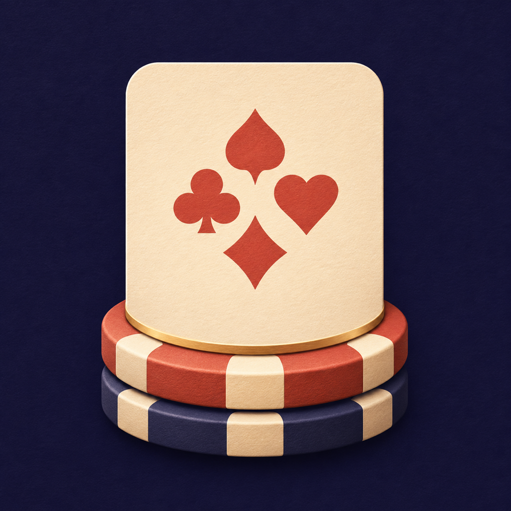

# PokerCalc

<p align="center">
  
</p>

<p align="center">
  <a href="#features">Features</a> ·
  <a href="#getting-started">Getting started</a> ·
  <a href="#testing">Testing</a> ·
  <a href="#project-layout">Project layout</a> ·
  <a href="#status">Status</a>
</p>

**One iPhone. Clear pots. No arguments.**

PokerCalc is a calm scorekeeper and pot-calculation companion for No-Limit Texas
Hold'em. One dealer or host runs the game and taps each announced action; the app
keeps stacks, blinds, turn order, side pots, and history straight so the group can
focus on playing.


## Features

- **Strict betting engine** — legal raise-to sizes, all-ins, short all-ins, side pots,
  split pots, and undo across every street. Point conservation is asserted in debug builds.
- **Dealer-first table** — the actor, street, legal actions, pot, stacks, and the exact
  effect of Undo remain obvious while lower-frequency table tools stay separate.
- **Confident betting** — legal raise limits, resulting totals, points added, stack
  after the action, and clamped Min, Half pot, Pot, and All-in presets.
- **Showdown checker** — a side sheet that never changes the game. Tap in the board and
  hole cards, get a plain-English winner explanation, and prefill it from any unawarded pot.
- **Learning without a lecture** — contextual poker vocabulary, an optional how-to-play
  reference, and a scannable strongest-to-weakest hand rankings guide.
- **Roster and history** — saved players, ordered seating, first-dealer choice, end-night
  review, and past nights with buy-ins, final stacks, and signed net results.
- **Built for real tables** — deliberate light and dark appearances, VoiceOver labels,
  Dynamic Type-aware layouts, non-color state cues, and monospaced point values.

No backend, no networking, no analytics, and no third-party runtime dependencies.

## Getting started

Requirements: Xcode 27.2 (Xcode 16+), an iOS 17+ Simulator or iPhone, and
[XcodeGen](https://github.com/yonaskolb/XcodeGen) for generating the Xcode project.

```bash
brew install xcodegen                 # skip if already installed
xcodegen generate
open PokerNight.xcodeproj
```

Choose an iPhone Simulator or a connected iPhone in Xcode and press **Run (⌘R)**.

The generated `PokerNight.xcodeproj` is intentionally not committed. After changing
`project.yml` or adding source files, run `xcodegen generate` again — never hand-edit
the generated project.

## Testing

```bash
cd PokerCore && swift test                 # PokerCore unit tests
cd ..
xcodebuild -project PokerNight.xcodeproj \
  -scheme PokerNight \
  -destination 'generic/platform=iOS Simulator' \
  CODE_SIGNING_ALLOWED=NO build

xcodebuild test -project PokerNight.xcodeproj \
  -scheme PokerNight \
  -destination 'platform=iOS Simulator,name=iPhone Duo' \
  CODE_SIGNING_ALLOWED=NO
```

Use `xcrun simctl list devices available` to pick a simulator name for your machine.
The app tests run on iOS Simulator; PokerCore tests also run natively on the Mac.

## Project layout

```text
PokerNight/
├── PLAN.md                  source of truth: spec, phases, status
├── project.yml              XcodeGen input (edit this, not the .xcodeproj)
├── PokerCore/               Swift package: cards, evaluator, betting engine, sessions
│   └── Tests/PokerCoreTests/ Swift Testing suites
├── PokerNight/              SwiftUI app
│   ├── App/                 root app model and navigation
│   ├── Features/            Home, Players, NightSetup, Table, Showdown, Rankings, History
│   ├── Persistence/         SwiftData models and active-night JSON store
│   └── Shared/              card view and semantic light/dark design system
└── PokerNightTests/         app-level tests for controller, setup, and persistence
```

All poker rules live in `PokerCore` as value types, independent of SwiftUI. The app
is a thin UI layer over a deterministic event log plus reducer-style replay.

## Installing on your own iPhone

The app is sideloaded from Xcode with a free Apple account:

1. Connect and unlock the iPhone, then trust this computer if prompted.
2. Enable **Settings → Privacy & Security → Developer Mode** (the phone restarts).
3. In Xcode, select the iPhone as the run destination and press **Run**.
4. On first launch, trust the developer profile under **Settings → General → VPN & Device Management**.

The free provisioning profile expires every 7 days; re-run from Xcode before game night.
Installing over the top preserves the roster and history — deleting the app does not.
A free account allows at most 3 sideloaded apps per device.

The Xcode target, module, bundle ID, and persistence identifiers intentionally retain
their original `PokerNight` names so existing installations and saved data remain
compatible. The installed display name and all user-facing branding are **PokerCalc**.

App details: bundle ID `com.uzayer.pokernight`, development team `ZMY7V3G25Z`.

## Status

The original ten delivery phases and the PokerCalc UI/UX implementation are complete.
The current redesign plan, architecture audit, design tokens, screen hierarchy, and
validation strategy are documented in
[POKERCALC_REDESIGN.md](POKERCALC_REDESIGN.md).

Automated verification on 2026-11-27: **45 PokerCore tests** and **25 app test
methods** (32 runs including parameterized cases) pass on iPhone Duo / iOS 27.1,
and the generic iOS Simulator Release build succeeds.

Interactive Simulator playtesting, hands-on VoiceOver/Dynamic Type inspection,
physical-iPhone installation, and the release tag remain manual/owner-side steps.
See [PLAN.md](PLAN.md) for the exact checklists and authoritative phase status.
